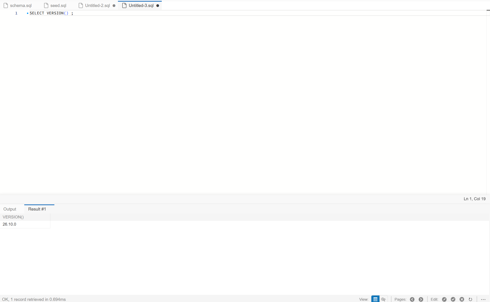

## 一、环境与说明

*   **MySQL 版本**：26.10.0
*   **连接方式**：Host: 127.0.0.1, Port: 3306, User: root
*   **运行顺序**：1. schema.sql -> 2. seed.sql -> 3. queries.sql

### 版本验证截图：
 

## 五、 理解与复现

### 1. 主键与外键的理解
*   **主键 (Primary Key)**：它能唯一标识一条记录（比如 books 表里的 `id`），不能重复，也不能为空。设置 `AUTO_INCREMENT` 后，每次插入新数据它都会自动生成。
*   **外键 (Foreign Key)**: 外键是连接两张表的桥梁,在`books`表中的`author_id`就是外键,外键保证了数据的一致性

### 真实遇到的问题及解决方法

> ** 问题一
> **问题描述**：在写 INSERT 插入数据时，代码逻辑和拼写完全正确，但一直报 `SQL Error (1064)`。但是两段代码单独选中运行能成功，放在一起运行就报错。
> **解决方法**：经过对DeepSeek的拷打,按照他说的改了n次之后,最终并不知道为什么,但是换了一个新文件就好了。

> **【问题 B：多表联查时的列名歧义】**
> **问题描述**：在写多表连接查询（JOIN）时，代码报错 `Column 'id' in order clause is ambiguous`（id 列有歧义）。因为 books 表和 authors 表里都有一个叫 `id` 的字段，当我在 ORDER BY 中写 `ORDER BY id` 时，数据库不知道我指的是哪张表的 id。
> **解决方法**：在 `ORDER BY` 后面明确指定表别名（如 `ORDER BY b.id`），或者直接用 `ORDER BY books.id`，告诉数据库按指定的表进行排序。

### 3. 主动验证的边界条件 (可选写)
在修改库存时，我主动通过 `UPDATE books SET stock = stock - 1` 进行了测试，并观察了库存为 0 时的状态，理解了在实际业务中，为了防止超卖，通常需要在 UPDATE 语句后加上 `WHERE stock > 0` 的条件限制。